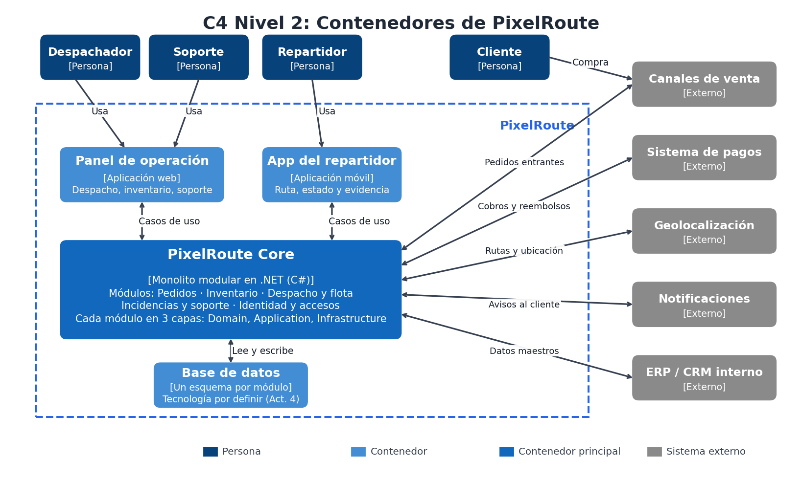
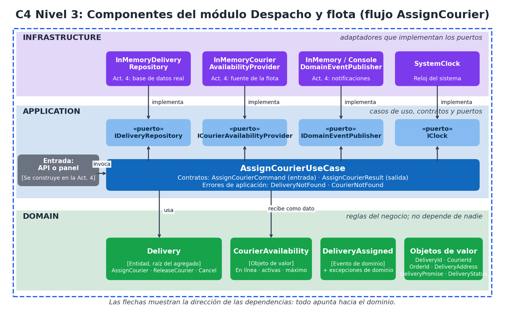
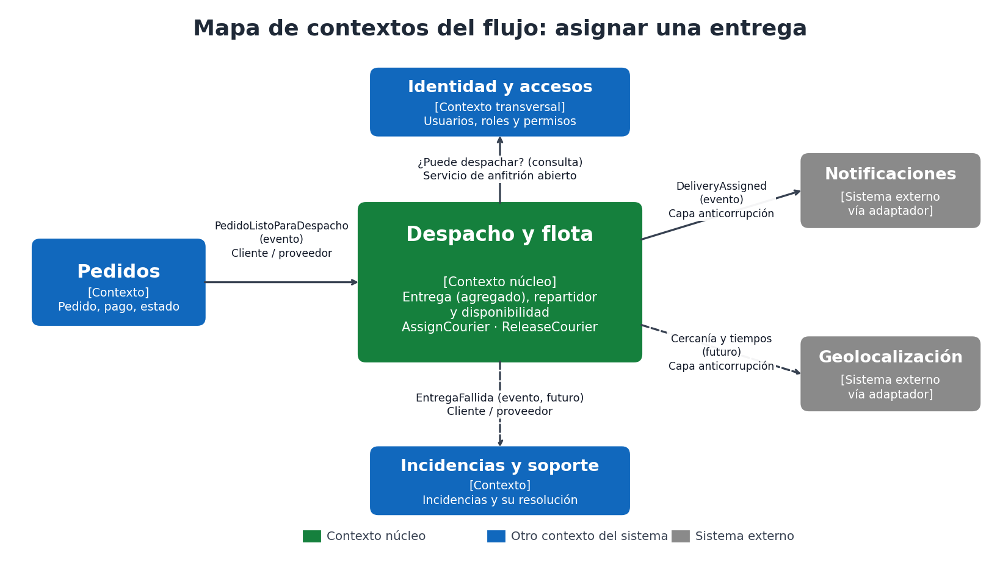
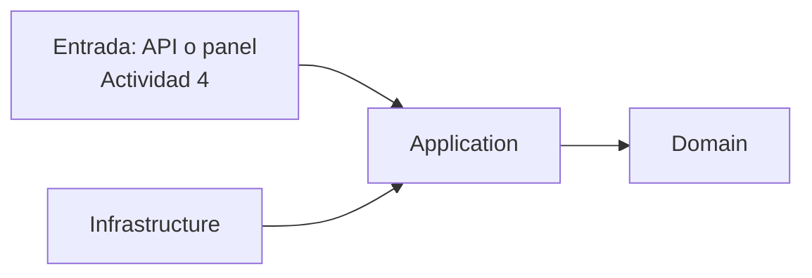

# Architecture.md: PixelRoute

> Proyecto académico y ficticio, inspirado en la comunidad de Roblox. No está afiliado a Roblox Corporation.
> Este documento describe la arquitectura de PixelRoute y sus límites. Se actualiza con cada actividad. Última actualización: **Actividad 3, Diseño y dominio**.

## 1. Introducción y objetivos

**PixelRoute** es la plataforma de gestión logística de última milla de **PixelPack**, una empresa de retail digital (ficticia) que promete entregar en 3 horas o menos desde 6 micro-bodegas, con repartidores independientes.

**Problema:** no existe una vista centralizada del estado real de cada pedido, lo que genera duplicación, entregas fuera de plazo, errores operativos y poca trazabilidad ([diagnóstico](docs/actividad-2/00-contexto-y-diagnostico.md)).

**Objetivos de calidad principales** (detalle en [escenarios de calidad](docs/actividad-2/03-escenarios-de-calidad.md)):

| Prioridad | Objetivo |
|---|---|
| 1 | Consistencia de inventario y pedidos: 0 sobreventas y 0 despachos duplicados. |
| 2 | Trazabilidad completa de cada pedido. |
| 3 | Evolución y testabilidad: la lógica de negocio cambia sin depender de infraestructura. |
| 4 | Escalabilidad ante picos (600 pedidos por hora) y resiliencia ante fallas externas. |
| 5 | Seguridad y privacidad, incluidos los datos de menores. |

## 2. Restricciones
- Se integra con el ERP/CRM existente; no se reemplaza (RES-01).
- Pagos, geolocalización y notificaciones son servicios externos (RES-02).
- Protección de datos personales, con atención a menores (RES-03).
- Equipo pequeño y presupuesto limitado (RES-04).
- El código de esta actividad usa **C# con .NET**, siguiendo el ejemplo de la actividad. La base de datos y otras tecnologías se deciden en la Actividad 4.

## 3. Contexto y alcance (C4 nivel 1)


PixelRoute interactúa con cuatro tipos de personas (cliente, despachador, repartidor y soporte) y cinco sistemas externos (canales de venta, pagos, geolocalización, notificaciones y ERP/CRM).

## 4. Estrategia de solución
| Decisión | Resumen | Documento |
|---|---|---|
| Monolito modular por dominios con puertos y adaptadores | Un solo despliegue dividido en módulos con límites claros. | [ADR-001](docs/actividad-2/06-adr-001-monolito-modular.md) |
| Tres capas con dependencias hacia el dominio | Domain, Application, Infrastructure. | [ADR-002](docs/actividad-3/adr/ADR-002-tres-capas-y-direccion-de-dependencias.md) |
| Agregado `Delivery` que protege sus invariantes | Las reglas viven en la entidad, no en el caso de uso ni en la base de datos. | [ADR-003](docs/actividad-3/adr/ADR-003-agregado-delivery-e-invariantes.md) |
| Puertos de salida, eventos de dominio y reloj | El caso de uso solo depende de interfaces. | [ADR-004](docs/actividad-3/adr/ADR-004-puertos-eventos-y-consistencia.md) |

## 5. Vista de contenedores (C4 nivel 2)


| Contenedor | Responsabilidad | Estado |
|---|---|---|
| Panel de operación (web) | Despacho, inventario y soporte | Por construir |
| App del repartidor (móvil) | Ruta, estado de entrega y evidencia | Por construir |
| **PixelRoute Core** (monolito modular, C#/.NET) | Todos los módulos de negocio | **Flujo "asignar entrega" modelado e implementado en memoria** |
| Base de datos (un esquema por módulo) | Persistencia | Tecnología por definir en la Actividad 4 |

## 6. Vista de componentes (C4 nivel 3): módulo Despacho y flota


| Capa | Proyecto | Contiene |
|---|---|---|
| **Domain** | `src/Domain` | `Delivery` (entidad raíz), `CourierAvailability`, `DeliveryAddress`, `DeliveryPromise`, identificadores, `DeliveryStatus`, evento `DeliveryAssigned`, excepciones de dominio |
| **Application** | `src/Application` | `AssignCourierUseCase`, contratos `AssignCourierCommand` y `AssignCourierResult`, errores de aplicación y los puertos `IDeliveryRepository`, `ICourierAvailabilityProvider`, `IDomainEventPublisher`, `IClock` |
| **Infrastructure** | `src/Infrastructure` | Adaptadores en memoria de los puertos, `ConsoleDomainEventPublisher` y `SystemClock` |
| **Tests** | `tests/PixelRoute.Tests` | Pruebas del dominio, del caso de uso con puertos falsos, del flujo con adaptadores en memoria y de reglas de arquitectura |

## 7. Vista de dominio
- [Flujo de negocio](docs/actividad-3/00-flujo-de-negocio.md)
- [Lenguaje ubicuo y términos ambiguos](docs/actividad-3/01-lenguaje-ubicuo.md)
- [Modelo de dominio, estados y transiciones](docs/actividad-3/02-modelo-de-dominio.md)
- [Invariantes y escenarios Dado-Cuando-Entonces](docs/actividad-3/03-invariantes-y-escenarios.md)

## 8. Contextos y contratos


Detalle de relaciones, contratos y errores en [contextos y contratos](docs/actividad-3/04-contextos-y-contratos.md).

## 9. Dependencias y reglas


**Reglas:**
1. El dominio no referencia a nadie.
2. La aplicación solo referencia al dominio y define los puertos.
3. La infraestructura implementa los puertos y no contiene reglas de negocio.
4. Los casos de uso reciben sus dependencias por constructor y no crean clases de infraestructura.

Se comprueban con `DependencyRulesTests`.

## 10. Conceptos transversales
| Tema | Tratamiento |
|---|---|
| Errores de negocio | Excepciones de dominio con mensajes en lenguaje del negocio; la entrada decide cómo traducirlas. |
| Eventos | La entidad registra eventos y el caso de uso los publica por un puerto tras guardar. |
| Tiempo | Siempre mediante el puerto `IClock`. |
| Seguridad y privacidad | Los contratos solo viajan identificadores y lo mínimo necesario; el permiso de despachador lo consulta el contexto Identidad y accesos. |

## 11. Riesgos y deuda técnica
| Riesgo o deuda | Detalle | Cuándo se atiende |
|---|---|---|
| Doble escritura (guardar y publicar) | Si falla la publicación, el aviso podría perderse. | Actividad 4: salida confiable de eventos |
| Concurrencia en la asignación | Dos asignaciones simultáneas podrían violar INV-01. | Actividad 4: control de versión optimista |
| Adaptadores en memoria | No hay persistencia ni integraciones reales. | Actividad 4 |
| Transiciones aún no implementadas | En ruta, Entregada, Fallida y reprogramación. | Actividad 4 |
| Supuestos pendientes de confirmar | Máximo de 3 entregas activas (S8), definición de "disponible" y "ruta saturada". | [Términos ambiguos](docs/actividad-3/01-lenguaje-ubicuo.md) |

## 12. Cómo ejecutar
```bash
dotnet build
dotnet test
```

## 13. Historial de documentos
| Actividad | Contenido |
|---|---|
| Actividad 2 | Requisitos, escenarios de calidad, comparación de alternativas y [ADR-001](docs/actividad-2/06-adr-001-monolito-modular.md) (carpeta `docs/actividad-2`) |
| **Actividad 3** | Modelo de dominio, casos de uso, puertos y adaptadores, C4, Architecture.md y ADR-002 a ADR-004 (carpeta `docs/actividad-3`, código en `src` y `tests`) |
