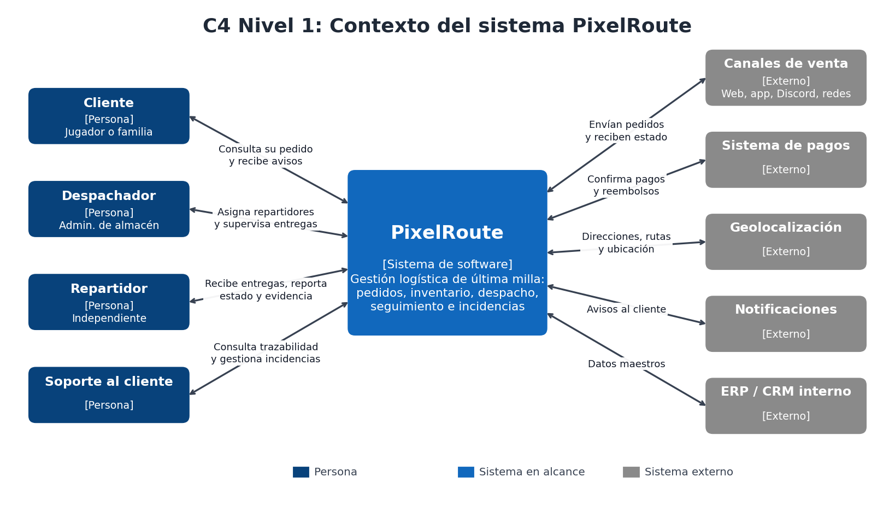
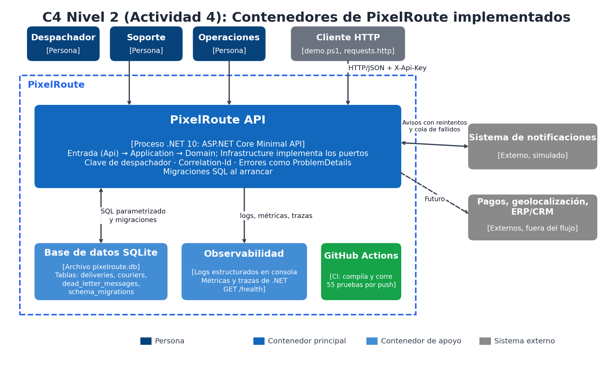
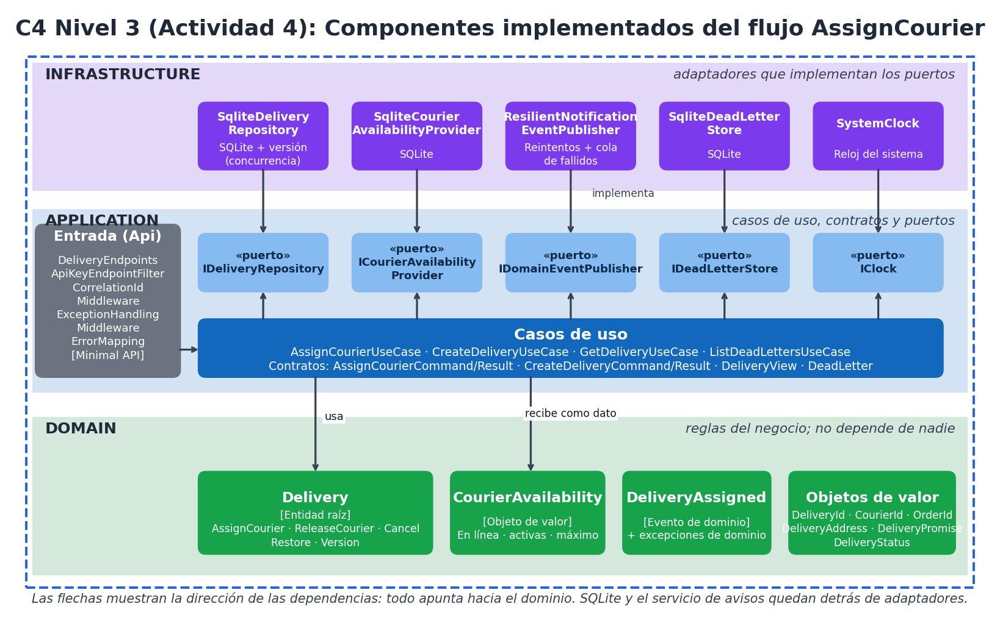
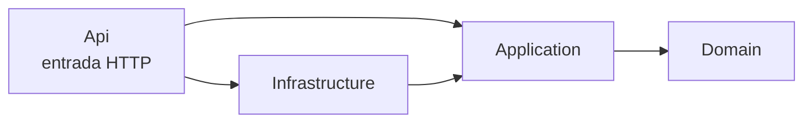

# Architecture.md: PixelRoute

> Proyecto académico y ficticio, inspirado en la comunidad de Roblox. No está afiliado a Roblox Corporation.
> Este documento es el expediente arquitectónico y se actualiza con cada actividad. Última actualización: **Actividad 4, Construcción, validación y defensa final**.

## 1. Introducción y objetivos

**PixelRoute** es la plataforma de gestión logística de última milla de **PixelPack**, una empresa de retail digital (ficticia) que promete entregar en 3 horas o menos desde 6 micro-bodegas, con repartidores independientes.

**Problema:** no existe una vista centralizada del estado real de cada pedido, lo que genera duplicación, entregas fuera de plazo, errores operativos y poca trazabilidad ([diagnóstico](docs/actividad-2/00-contexto-y-diagnostico.md)).

**Objetivos de calidad** (detalle en los [escenarios de calidad](docs/actividad-2/03-escenarios-de-calidad.md)):

| Prioridad | Objetivo | Estado en la Actividad 4 |
|---|---|---|
| 1 | Consistencia de inventario y pedidos: 0 sobreventas y 0 despachos duplicados | Parcial: una entrega no se asigna dos veces (probado); el cupo del repartidor tiene un riesgo residual (RO-12) |
| 2 | Trazabilidad completa de cada pedido | Parcial: registros con correlación; falta el historial de estados |
| 3 | Evolución y testabilidad | Cumplido para el flujo: 55 pruebas y reglas de arquitectura automáticas |
| 4 | Escalabilidad ante picos y resiliencia ante fallas externas | Resiliencia probada (avisos); escalabilidad **no validada** (RO-11) |
| 5 | Seguridad y privacidad, incluidos los datos de menores | Seguridad mínima implementada; datos de menores pendientes |

## 2. Restricciones
- Se integra con el ERP/CRM existente; no se reemplaza (RES-01).
- Pagos, geolocalización y notificaciones son servicios externos (RES-02).
- Protección de datos personales, con atención a menores (RES-03).
- Equipo pequeño y presupuesto limitado (RES-04).
- Tecnología elegida en la Actividad 4: **C# con .NET 10**, ASP.NET Core Minimal API y **SQLite** ([ADR-005](docs/actividad-4/adr/ADR-005-api-rest-y-vertical-slice.md) y [ADR-006](docs/actividad-4/adr/ADR-006-persistencia-migraciones-y-concurrencia.md)).

## 3. Contexto y alcance (C4 nivel 1)


PixelRoute interactúa con cuatro tipos de personas (cliente, despachador, repartidor y soporte) y cinco sistemas externos (canales de venta, pagos, geolocalización, notificaciones y ERP/CRM).

**Alcance implementado:** el flujo **asignar un repartidor a una entrega**, con crear y consultar entregas como apoyo.

## 4. Estrategia de solución y decisiones
| Decisión | Resumen | Documento |
|---|---|---|
| Monolito modular por dominios con puertos y adaptadores | Un solo despliegue dividido en módulos con límites claros | [ADR-001](docs/actividad-2/06-adr-001-monolito-modular.md) |
| Tres capas con dependencias hacia el dominio | Domain, Application, Infrastructure | [ADR-002](docs/actividad-3/adr/ADR-002-tres-capas-y-direccion-de-dependencias.md) |
| Agregado `Delivery` que protege sus invariantes | Las reglas viven en la entidad | [ADR-003](docs/actividad-3/adr/ADR-003-agregado-delivery-e-invariantes.md) |
| Puertos de salida, eventos de dominio y reloj | El caso de uso solo depende de interfaces | [ADR-004](docs/actividad-3/adr/ADR-004-puertos-eventos-y-consistencia.md) |
| Entrada REST con Minimal API y vertical slice | Cuatro endpoints y `/health` | [ADR-005](docs/actividad-4/adr/ADR-005-api-rest-y-vertical-slice.md) |
| SQLite, migraciones SQL y concurrencia optimista | Esquema versionado y control de versión | [ADR-006](docs/actividad-4/adr/ADR-006-persistencia-migraciones-y-concurrencia.md) |
| Notificaciones con reintentos y cola de fallidos | La falla de avisos no deshace la asignación | [ADR-007](docs/actividad-4/adr/ADR-007-notificaciones-resilientes-y-cola-de-fallidos.md) |
| Seguridad mínima, observabilidad y verificación | Clave, correlación, señales y funciones de aptitud | [ADR-008](docs/actividad-4/adr/ADR-008-seguridad-observabilidad-y-verificacion.md) |

## 5. Vista de contenedores (C4 nivel 2)


| Contenedor | Responsabilidad | Estado |
|---|---|---|
| **PixelRoute API** (proceso .NET 10) | Entrada HTTP, casos de uso, dominio y adaptadores | **Implementado** |
| Base de datos SQLite (`pixelroute.db`) | Entregas, repartidores, mensajes fallidos y registro de migraciones | **Implementado** |
| Observabilidad | Registros, métricas, trazas y `/health` | **Implementado** (sin exportador) |
| GitHub Actions | Compila y ejecuta las pruebas en cada cambio | **Implementado** |
| Panel de operación y app del repartidor | Interfaces de usuario | Por construir |
| Sistema de notificaciones | Avisos al cliente | **Simulado** |
| Pagos, geolocalización, ERP/CRM | Integraciones externas | Fuera del flujo |

## 6. Vista de componentes (C4 nivel 3): flujo AssignCourier


| Capa | Proyecto | Contiene |
|---|---|---|
| **Entrada (Api)** | `src/Api` | `DeliveryEndpoints`, `ApiKeyEndpointFilter`, `CorrelationIdMiddleware`, `ExceptionHandlingMiddleware`, `ErrorMapping`, `Program.cs` (raíz de composición) |
| **Application** | `src/Application` | Casos de uso (`AssignCourier`, `CreateDelivery`, `GetDelivery`, `ListDeadLetters`), contratos y puertos |
| **Domain** | `src/Domain` | `Delivery`, `CourierAvailability`, objetos de valor, `DeliveryAssigned`, excepciones de dominio |
| **Infrastructure** | `src/Infrastructure` | Repositorio SQLite, disponibilidad de repartidores, cola de fallidos, migraciones, publicador resiliente, servicio de avisos simulado, reloj y telemetría |
| **Tests** | `tests/PixelRoute.Tests` | 55 pruebas: dominio, aplicación, infraestructura, integración por HTTP y arquitectura |

## 7. Vista de dominio
- [Flujo de negocio](docs/actividad-3/00-flujo-de-negocio.md)
- [Lenguaje ubicuo y términos ambiguos](docs/actividad-3/01-lenguaje-ubicuo.md)
- [Modelo de dominio, estados y transiciones](docs/actividad-3/02-modelo-de-dominio.md)
- [Invariantes y escenarios Dado-Cuando-Entonces](docs/actividad-3/03-invariantes-y-escenarios.md)

## 8. Contextos y contratos


Detalle en [contextos y contratos](docs/actividad-3/04-contextos-y-contratos.md).

## 9. Dependencias y reglas


**Reglas** (comprobadas automáticamente por `DependencyRulesTests` y `FitnessFunctionTests`):
1. Domain no referencia a nadie ni usa paquetes externos de Microsoft.
2. Application solo referencia a Domain y define los puertos.
3. Infrastructure implementa los puertos, no contiene reglas de negocio y no usa ASP.NET Core.
4. Los casos de uso reciben sus dependencias por constructor y solo reciben interfaces.
5. `Delivery` no tiene setters públicos: solo se modifica por sus métodos.
6. Solo Api (`Program.cs`) elige adaptadores concretos.

## 10. Flujo de ejecución del vertical slice
Ver el diagrama de secuencia en el [documento 00 de la Actividad 4](docs/actividad-4/00-plan-y-trazabilidad.md).

## 11. Conceptos transversales
| Tema | Tratamiento |
|---|---|
| Errores de negocio | Excepciones de dominio con mensajes del negocio; `ErrorMapping` las traduce a HTTP (404, 409, 422, 400, 500) |
| Eventos | La entidad registra eventos; el caso de uso los publica por un puerto tras guardar |
| Fallas externas | Reintentos con espera exponencial y cola de mensajes fallidos |
| Persistencia | SQLite, SQL parametrizado, migraciones versionadas y control de versión optimista |
| Seguridad | Clave de despachador, validación, errores sin detalles, datos mínimos en las respuestas |
| Observabilidad | Registros con correlación, métricas, trazas y `/health`, sin datos sensibles ([documento 03](docs/actividad-4/03-observabilidad.md)) |
| Tiempo | Siempre mediante el puerto `IClock` |

## 12. Riesgos, riesgos residuales y deuda técnica
Riesgos completos en el [documento 02 de la Actividad 4](docs/actividad-4/02-riesgos-seguridad-y-operacion.md). Los residuales:

| Riesgo o deuda | Detalle | Próximo paso |
|---|---|---|
| Doble escritura (RO-02) | Un corte entre guardar y publicar pierde el aviso | Outbox transaccional |
| Escalabilidad no validada (RO-11) | SQLite y sin prueba de carga | PostgreSQL y prueba de carga |
| Cupo del repartidor (RO-12) | Asignaciones simultáneas de entregas distintas | Operación atómica |
| Seguridad (RO-05 y RO-14) | Una clave compartida y sin límite de solicitudes | JWT, roles y limitación |
| Transiciones pendientes | En ruta, Entregada, Fallida y reprogramación | Siguientes iteraciones |
| Notificaciones simuladas | No hay proveedor real | Adaptador real detrás de `INotificationGateway` |

## 13. Cómo construir, probar y ejecutar
```powershell
dotnet build
dotnet test
dotnet run --project src/Api
```
Instrucciones completas en el [README](README.md).

## 14. Historial de documentos
| Actividad | Contenido |
|---|---|
| Actividad 2 | Requisitos, escenarios de calidad, comparación de alternativas y ADR-001 (`docs/actividad-2`) |
| Actividad 3 | Modelo de dominio, casos de uso, puertos y adaptadores, C4, ADR-002 a ADR-004 (`docs/actividad-3`) |
| **Actividad 4** | Implementación, persistencia, integración, pruebas, riesgos, observabilidad, C4 actualizado y ADR-005 a ADR-008 (`docs/actividad-4`, `src`, `tests`) |
