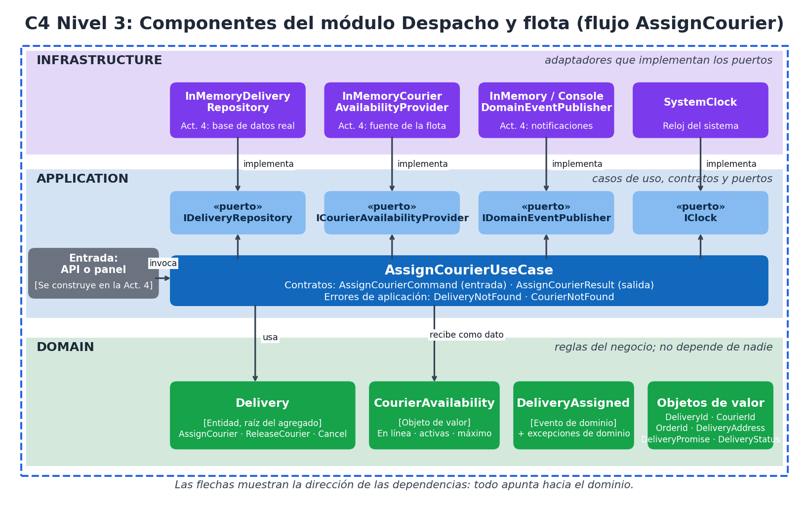

# PixelRoute: plataforma de logística de última milla para PixelPack

> **Actividad 3: Diseño y dominio**
> Proyecto académico y ficticio, inspirado en la comunidad de Roblox. No está afiliado a Roblox Corporation.

PixelPack es una empresa de retail digital (ficticia) que vende productos físicos temáticos de Roblox y promete **entregar en 3 horas o menos** desde 6 micro-bodegas, con repartidores independientes. PixelRoute es la plataforma que centraliza pedidos, inventario, despacho, seguimiento e incidencias. El contexto y las decisiones iniciales vienen de la [Actividad 2](docs/actividad-2/00-contexto-y-diagnostico.md).

## Propuesta de esta actividad

### Flujo elegido: asignar un repartidor a una entrega
Es el punto donde se juegan la promesa de 3 horas, la disponibilidad variable de los repartidores independientes y la trazabilidad. Detalle en [el flujo de negocio](docs/actividad-3/00-flujo-de-negocio.md).

### Modelo de dominio
- **Entidad raíz:** `Delivery` (Entrega), con identidad y estados `Pending → Assigned → InRoute → Delivered`, más `Failed` y `Cancelled`.
- **Objetos de valor:** `DeliveryId`, `CourierId`, `OrderId`, `DeliveryAddress`, `DeliveryPromise` y `CourierAvailability`.
- **Evento de dominio:** `DeliveryAssigned`.
- **Invariantes protegidas por la entidad:** un solo repartidor por entrega, solo se asignan entregas Pendientes, el repartidor debe estar en línea y su ruta no puede estar saturada, la dirección es obligatoria y la promesa no cambia.

### Tres capas y dirección de dependencias
| Capa | Carpeta | Contiene |
|---|---|---|
| **Domain** | `src/Domain` | Entidades, objetos de valor, invariantes y eventos |
| **Application** | `src/Application` | `AssignCourierUseCase`, contratos y puertos |
| **Infrastructure** | `src/Infrastructure` | Adaptadores (en memoria por ahora) |

Las dependencias apuntan hacia el dominio: **Infrastructure → Application → Domain**. Se comprueban con pruebas de arquitectura.

### Puertos y adaptadores
| Puerto (Application) | Adaptadores (Infrastructure) |
|---|---|
| `IDeliveryRepository` | `InMemoryDeliveryRepository` |
| `ICourierAvailabilityProvider` | `InMemoryCourierAvailabilityProvider` |
| `IDomainEventPublisher` | `InMemoryDomainEventPublisher`, `ConsoleDomainEventPublisher` |
| `IClock` | `SystemClock` |



### Escenarios de aceptación
Once escenarios en formato Dado-Cuando-Entonces (E-01 a E-11), cada uno ligado a una prueba automática. Ver [invariantes y escenarios](docs/actividad-3/03-invariantes-y-escenarios.md).

### Decisiones de diseño (ADR)
| ADR | Decisión |
|---|---|
| [ADR-001](docs/actividad-2/06-adr-001-monolito-modular.md) | Monolito modular por dominios con puertos y adaptadores (Actividad 2) |
| [ADR-002](docs/actividad-3/adr/ADR-002-tres-capas-y-direccion-de-dependencias.md) | Tres capas con dependencias hacia el dominio |
| [ADR-003](docs/actividad-3/adr/ADR-003-agregado-delivery-e-invariantes.md) | Agregado `Delivery` que protege sus invariantes |
| [ADR-004](docs/actividad-3/adr/ADR-004-puertos-eventos-y-consistencia.md) | Puertos de salida, eventos de dominio y consistencia |

## Documentación
| Documento | Descripción |
|---|---|
| [Architecture.md](Architecture.md) | Arquitectura, diagramas C4 (niveles 1, 2 y 3), capas, decisiones y deuda técnica |
| [00-flujo-de-negocio](docs/actividad-3/00-flujo-de-negocio.md) | Flujo, actores, propósito y resultado esperado |
| [01-lenguaje-ubicuo](docs/actividad-3/01-lenguaje-ubicuo.md) | Glosario y términos ambiguos por confirmar |
| [02-modelo-de-dominio](docs/actividad-3/02-modelo-de-dominio.md) | Entidades, objetos de valor, estados y transiciones |
| [03-invariantes-y-escenarios](docs/actividad-3/03-invariantes-y-escenarios.md) | Invariantes y escenarios Dado-Cuando-Entonces |
| [04-contextos-y-contratos](docs/actividad-3/04-contextos-y-contratos.md) | Contextos delimitados, mapa de contextos y contratos |
| [05-casos-de-uso-puertos-adaptadores](docs/actividad-3/05-casos-de-uso-puertos-adaptadores.md) | Casos de uso, puertos, adaptadores y dependencias |
| [06-guion-video](docs/actividad-3/06-guion-video.md) | Guion del video de sustentación |
| [docs/actividad-2](docs/actividad-2/) | Documentos de la Actividad 2 (requisitos, escenarios de calidad, alternativas y ADR-001) |

## Cómo ejecutar
Requiere el SDK de .NET. Si tienes una versión distinta de .NET 8, cambia `TargetFramework` en `Directory.Build.props` (es la única línea que hay que tocar).

```bash
dotnet build
dotnet test
```

## Estructura
```
src/
  Domain/            reglas del negocio
  Application/       casos de uso, contratos y puertos
  Infrastructure/    adaptadores
tests/
  PixelRoute.Tests/  dominio, caso de uso, flujo y arquitectura
docs/
  actividad-2/       requisitos y decisión estructural
  actividad-3/       diseño y dominio
Architecture.md
```

## Alcance
Esta actividad evalúa el **diseño**. No incluye persistencia real ni integraciones externas, que corresponden a la Actividad 4.

## Video de sustentación
_(pegar aquí el enlace de YouTube, Google Drive o Teams cuando esté publicado)_

## Autor
Andrés Barrera Claros
