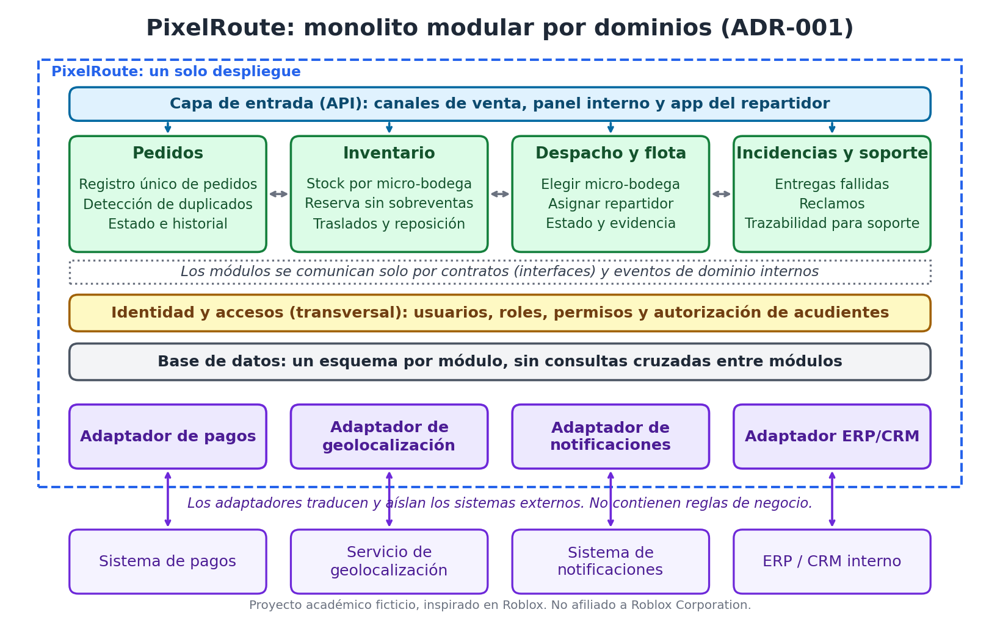
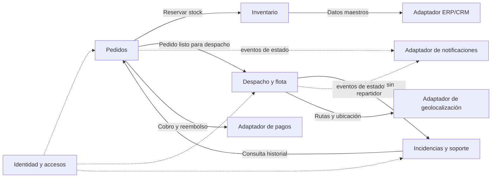
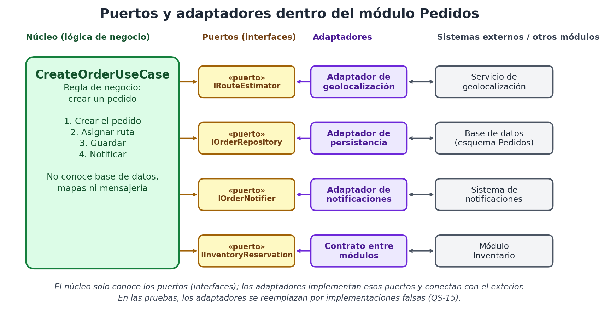

# 04. Dominios y límites de contexto

Antes de comparar alternativas necesitaba saber **qué partes tiene el problema**, porque eso no depende de si luego se construye como un solo sistema o como varios. Apliqué las ideas de los videos 05 y 06: **alta cohesión** (cada parte hace una sola cosa bien) y **bajo acoplamiento** (las partes se conocen lo mínimo).

## Contextos delimitados

| Contexto | Responsabilidad | Datos que le pertenecen | Contrato que ofrece |
|---|---|---|---|
| **Pedidos** | Registrar pedidos de todos los canales, evitar duplicados y llevar estado e historial. | Pedido, estado, historial de eventos. | Crear pedido, consultar estado e historial, cancelar. |
| **Inventario** | Saber cuánto hay en cada micro-bodega y reservar stock sin sobreventas. | Productos, existencias por bodega, reservas. | Consultar disponibilidad, reservar, liberar, registrar movimiento. |
| **Despacho y flota** | Elegir la micro-bodega, asignar repartidores y seguir la entrega. | Repartidores, ofertas, asignaciones, estado y evidencia de entrega. | Elegir bodega, ofrecer pedido, actualizar estado de entrega. |
| **Incidencias y soporte** | Registrar y resolver retrasos, entregas fallidas y reclamos. | Incidencias y su resolución. | Registrar incidencia, consultar incidencias de un pedido. |
| **Identidad y accesos** (transversal) | Autenticar, controlar permisos por rol y guardar autorizaciones de acudientes. | Usuarios, roles, permisos, autorizaciones. | Verificar permiso de un usuario. |

Los sistemas externos (pagos, geolocalización, notificaciones, ERP/CRM) se conectan mediante **adaptadores** sin reglas de negocio. Los canales de venta entran por la capa de entrada.

## Cómo se relacionan

## Estructura interna de cada módulo: puertos y adaptadores
Dentro de cada módulo la lógica de negocio (los **casos de uso**) no conoce la infraestructura. Solo conoce **puertos**: interfaces que describen lo que necesita. Los **adaptadores** implementan esos puertos (base de datos, servicio de mapas, envío de avisos). Esta es la idea que mostró el profesor con `CreateOrderUseCase` y se explica en el [documento 08](08-ejemplo-de-contratos.md).

## Eventos de dominio
En lugar de que un módulo llame a otro cada vez que algo cambia, publica un evento y los interesados reaccionan:

`PedidoConfirmado`, `StockReservado`, `StockInsuficiente`, `PedidoListoParaDespacho`, `OfertaEnviada`, `RepartidorAsignado`, `EstadoEntregaActualizado`, `EntregaFallida`, `IncidenciaRegistrada`.

## Reglas de acoplamiento
1. Cada módulo es **dueño de sus datos**: ningún otro lee sus tablas directamente.
2. Los módulos se comunican **solo por contratos** (interfaces públicas) o **eventos de dominio**.
3. La lógica de negocio depende de **puertos**, nunca de clases concretas de infraestructura.
4. Las reglas de negocio viven en el módulo al que pertenecen, nunca en un adaptador.
5. Los adaptadores traducen entre el modelo externo y el nuestro, para que un cambio en un sistema externo no se propague.
6. No hay dependencias circulares entre módulos.

Estas reglas se comprueban con los [criterios verificables](07-criterios-verificables.md).
