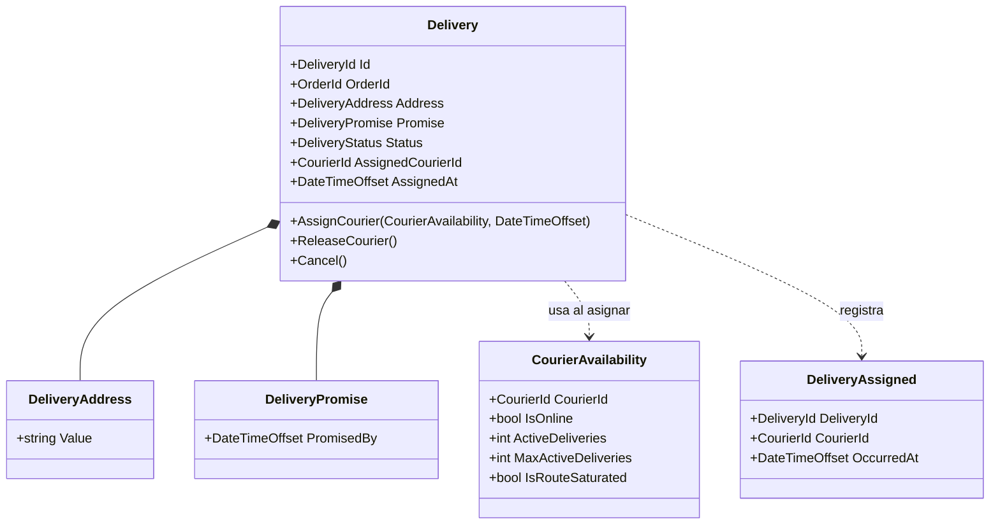
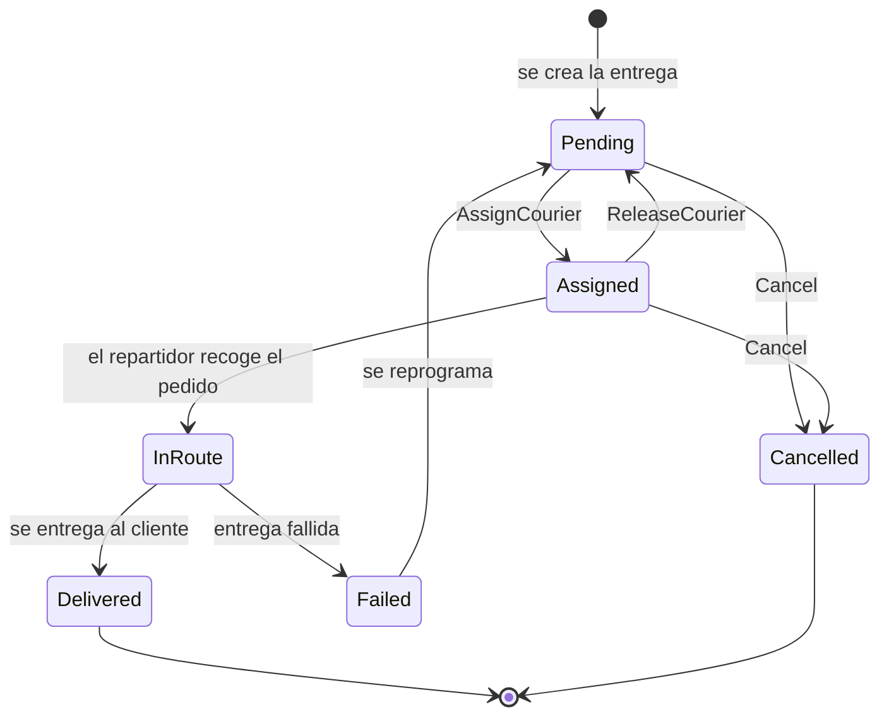

# 02. Modelo de dominio

## Entidades y objetos de valor

**Una entidad** tiene identidad propia: dos entregas con la misma dirección siguen siendo entregas distintas. **Un objeto de valor** no tiene identidad: se define por sus atributos y es inmutable.

| Concepto | Clasificación | Identidad | Responsabilidad |
|---|---|---|---|
| `Delivery` (Entrega) | **Entidad, raíz del agregado** | `DeliveryId` | Protege las invariantes de la asignación y gobierna los cambios de estado. |
| `Courier` (Repartidor) | Entidad (contexto Despacho y flota) | `CourierId` | Fuente de la disponibilidad. En este flujo solo se usa su "foto" (`CourierAvailability`). |
| `DeliveryId`, `CourierId`, `OrderId` | Objetos de valor (identificadores) | Su valor (`Guid`) | Evitan confundir identificadores entre sí. |
| `DeliveryAddress` | Objeto de valor | Por su texto | Garantiza que la dirección no esté vacía. |
| `DeliveryPromise` | Objeto de valor | Por su fecha límite | Calcula la hora prometida (creación + 3 horas). |
| `CourierAvailability` | Objeto de valor | Por sus atributos | Resume si el repartidor está en línea y cuántas entregas activas lleva. |
| `DeliveryStatus` | Enumeración | n/a | Estados válidos de la entrega. |
| `DeliveryAssigned` | Evento de dominio | n/a | Hecho: se asignó un repartidor. |

El agregado **Delivery** es la frontera de consistencia: todo cambio de estado o de repartidor pasa por sus métodos, nunca por asignaciones directas desde fuera (los setters son privados).

## Modelo de clases

## Estados y transiciones

| Transición | Cuándo ocurre | Regla clave | ¿Implementada en esta actividad? |
|---|---|---|---|
| Pendiente → Asignada | El despachador asigna un repartidor | INV-01, 02, 04, 05 | Sí (`AssignCourier`) |
| Asignada → Pendiente | El repartidor rechaza o se libera | Solo desde Asignada | Sí (`ReleaseCourier`) |
| Pendiente o Asignada → Cancelada | Se cancela el pedido | INV-06 | Sí (`Cancel`) |
| Asignada → En ruta | El repartidor recoge el pedido | Requiere repartidor | Diseñada; se implementa en la Actividad 4 |
| En ruta → Entregada | Se confirma la entrega con evidencia | Requiere evidencia (RF-12) | Diseñada; Actividad 4 |
| En ruta → Fallida | No se pudo entregar | Genera una incidencia | Diseñada; Actividad 4 |
| Fallida → Pendiente | Se reprograma o reasigna | RF-17 | Diseñada; Actividad 4 |

**Decisión sobre máquinas de estado:** no introduje una librería ni una máquina de estados de interfaz (video 25). Las transiciones viven como métodos de la entidad, porque el flujo no tiene estados de interfaz que controlar. Se justifica en el [ADR-003](adr/ADR-003-agregado-delivery-e-invariantes.md).

## Otros agregados del dominio logístico (fuera de este flujo)
Para mostrar la coherencia con el modelo general, estas son las reglas que la actividad menciona para otros conceptos. No se implementan ahora, pero respetarán el mismo diseño:

| Concepto | Regla |
|---|---|
| Pedido | No se confirma si el stock solicitado no está disponible (contexto Pedidos e Inventario). |
| Incidencia | No se cierra sin registrar resolución ni responsable (contexto Incidencias y soporte). |
| Devolución | Debe estar asociada a un pedido válido y a un motivo concreto. |
