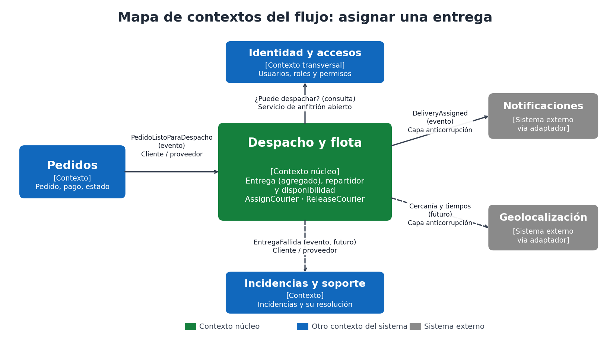

# 04. Contextos delimitados y contratos

Retomé los contextos de la [Actividad 2](../actividad-2/04-dominios-y-limites.md) y revisé cuáles intervienen en el flujo de asignar una entrega (idea del video 17: delimitar modelos y relaciones entre contextos).

## Contextos involucrados

| Contexto | Rol en el flujo | Modelo propio de "entrega" |
|---|---|---|
| **Despacho y flota** (núcleo) | Dueño de la entrega y del repartidor. Ejecuta la asignación. | Entrega con estado, repartidor, dirección y promesa. |
| **Pedidos** | Origen: avisa cuando un pedido está listo para despacho. | El pedido tiene productos, cliente y pago. **No** conoce repartidores. |
| **Identidad y accesos** | Decide si quien asigna tiene el permiso de despachador. | Usuarios, roles y permisos. |
| **Notificaciones** (sistema externo, vía adaptador) | Avisa al cliente cuando se asigna el repartidor. | Mensajes y destinatarios. |
| **Geolocalización** (sistema externo, vía adaptador) | Fuente futura de cercanía y tiempos. No participa en esta versión. | Coordenadas y rutas. |
| **Incidencias y soporte** | Recibe la entrega si la asignación o la entrega fallan (flujo posterior). | Incidencias y su resolución. |

La palabra "entrega" significa cosas distintas en cada contexto, y por eso cada contexto tiene su propio modelo. Despacho y flota solo guarda el `OrderId` del pedido, nunca el pedido completo.

## Relaciones y contratos

| Relación | Patrón | Contrato que intercambian | Dirección |
|---|---|---|---|
| Pedidos → Despacho y flota | **Cliente/proveedor** con lenguaje publicado | Evento `PedidoListoParaDespacho` con `orderId`, `address` y hora de creación. Despacho crea la entrega Pendiente. | Pedidos publica, Despacho consume |
| Identidad y accesos → Despacho y flota | **Servicio de anfitrión abierto** (consulta) | Consulta "¿el usuario U puede despachar?" | Despacho consulta |
| Despacho y flota → Notificaciones | **Capa anticorrupción** (adaptador) | Evento `DeliveryAssigned` (entrega, repartidor, hora). El adaptador lo traduce al formato del proveedor. | Despacho publica |
| Despacho y flota → Geolocalización | **Capa anticorrupción** (adaptador, versión futura) | Puerto de cercanía y estimación (similar a `IRouteEstimator`). | Despacho consulta |
| Despacho y flota → Incidencias y soporte | **Cliente/proveedor** por evento | Evento `EntregaFallida` o `EntregaSinRepartidor` (flujo posterior). | Despacho publica |

### Qué información viaja y qué no
- **Viaja:** identificadores (`orderId`, `deliveryId`, `courierId`), dirección de entrega, hora límite y el evento de la asignación.
- **No viaja:** los productos del pedido, los datos de pago, el nombre ni el teléfono del cliente. El repartidor solo ve la dirección completa después de aceptar (QS-09). Esto reduce el acoplamiento y protege datos personales, incluidos los de menores (RNF-07).

## Contratos de aplicación del caso de uso

| Contrato | Campos | Notas |
|---|---|---|
| `AssignCourierCommand` (entrada) | `DeliveryId: Guid`, `CourierId: Guid` | Tipos simples, para que cualquier entrada (API, pantalla, proceso) lo pueda invocar sin conocer el dominio. |
| `AssignCourierResult` (salida) | `DeliveryId`, `CourierId`, `Status: string`, `AssignedAt` | No expone la entidad `Delivery`; el dominio no sale de la aplicación. |

### Errores del contrato
Cada error tiene un significado de negocio. La entrada (por ejemplo, una API en la Actividad 4) decidirá cómo traducirlo; la aplicación no sabe de HTTP.

| Error | Origen | Significado | Traducción sugerida a futuro |
|---|---|---|---|
| `DeliveryNotFoundException` | Aplicación | La entrega no existe. | No encontrado |
| `CourierNotFoundException` | Aplicación | El repartidor no existe. | No encontrado |
| `DeliveryAlreadyAssignedException` | Dominio | Violación de INV-01. | Conflicto |
| `InvalidDeliveryStateException` | Dominio | Violación de INV-02 o INV-06. | Conflicto |
| `CourierNotAvailableException` | Dominio | Violación de INV-04. | Regla de negocio no cumplida |
| `CourierRouteSaturatedException` | Dominio | Violación de INV-05. | Regla de negocio no cumplida |
