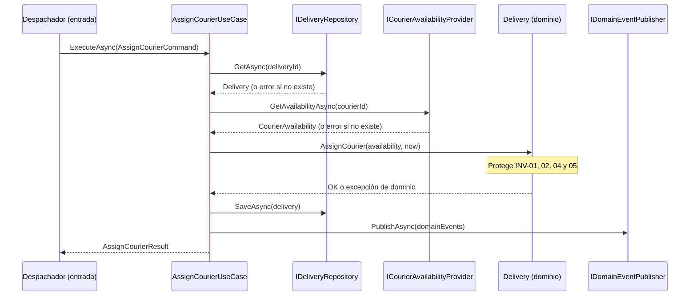
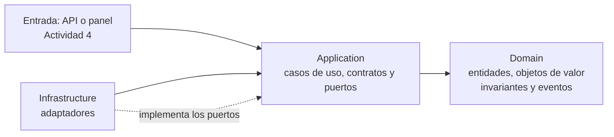
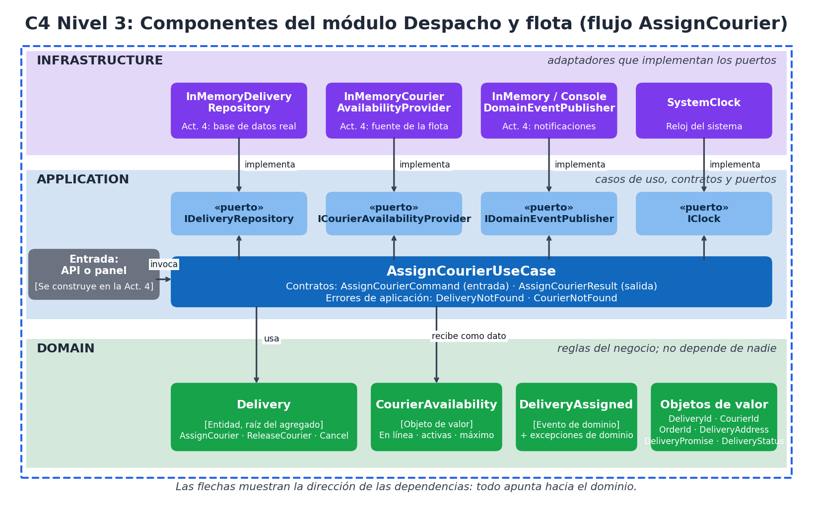

# 05. Casos de uso, puertos y adaptadores

## Casos de uso
Un caso de uso responde a la pregunta: **¿qué necesita hacer el usuario o el sistema?** Los de este flujo:

| Caso de uso | Intención | Estado |
|---|---|---|
| **`AssignCourierUseCase`** | Asignar un repartidor a una entrega pendiente. | **Modelado e implementado** con pruebas |
| `ReleaseCourierUseCase` | Liberar al repartidor de una entrega (rechazo o reasignación). | Diseñado; usa `Delivery.ReleaseCourier` |
| `GetDeliveryStatusUseCase` | Consultar el estado de una entrega para el cliente y soporte (RF-13). | Diseñado |
| `CreateDeliveryFromOrderUseCase` | Crear la entrega Pendiente al recibir `PedidoListoParaDespacho`. | Diseñado |

## Secuencia de `AssignCourierUseCase`

## Puertos
Los puertos los **define la capa Application** (expresan lo que el caso de uso necesita) y los **implementa la capa Infrastructure**.

| Puerto | Qué necesita el caso de uso | Adaptadores implementados | Adaptadores propuestos (Actividad 4) |
|---|---|---|---|
| `IDeliveryRepository` | Cargar y guardar entregas | `InMemoryDeliveryRepository` | Repositorio con base de datos real y control de versión |
| `ICourierAvailabilityProvider` | Saber si un repartidor está en línea y cuántas entregas lleva | `InMemoryCourierAvailabilityProvider` | Adaptador hacia el módulo de flota o la app del repartidor |
| `IDomainEventPublisher` | Publicar el resultado | `InMemoryDomainEventPublisher`, `ConsoleDomainEventPublisher` | Adaptador de notificaciones; salida confiable de eventos |
| `IClock` | Obtener la hora actual | `SystemClock` | (igual) |

Que haya **dos adaptadores** del mismo puerto de eventos demuestra que la infraestructura es intercambiable sin tocar el caso de uso.

## Dirección de las dependencias

**Regla:** las flechas apuntan hacia el dominio. El dominio no conoce a nadie; la aplicación solo conoce el dominio; la infraestructura conoce la aplicación para implementar sus puertos. Se comprueba automáticamente con `DependencyRulesTests`.

## SOLID aplicado
| Principio | Dónde se ve |
|---|---|
| **S**: responsabilidad única | `Delivery` protege reglas; `AssignCourierUseCase` coordina; cada adaptador hace una sola cosa. |
| **O**: abierto/cerrado | Se agrega un adaptador nuevo (por ejemplo, de notificaciones) sin modificar el caso de uso. |
| **L**: sustitución de Liskov | `InMemoryDomainEventPublisher` y `ConsoleDomainEventPublisher` son intercambiables. |
| **I**: segregación de interfaces | Puertos pequeños y específicos, en lugar de un único repositorio "para todo". |
| **D**: inversión de dependencias | El caso de uso depende de interfaces y recibe todo por constructor. |

## Separación entre dominio, aplicación e infraestructura
| Capa | Contiene | No debe contener |
|---|---|---|
| **Domain** | Entidades, objetos de valor, invariantes, eventos de dominio | Base de datos, HTTP, frameworks, relojes del sistema |
| **Application** | Casos de uso, contratos (comandos y resultados), puertos | Clases concretas de infraestructura; `SqlConnection`, `HttpClient` |
| **Infrastructure** | Adaptadores: repositorios, publicadores, reloj | Reglas de negocio |
